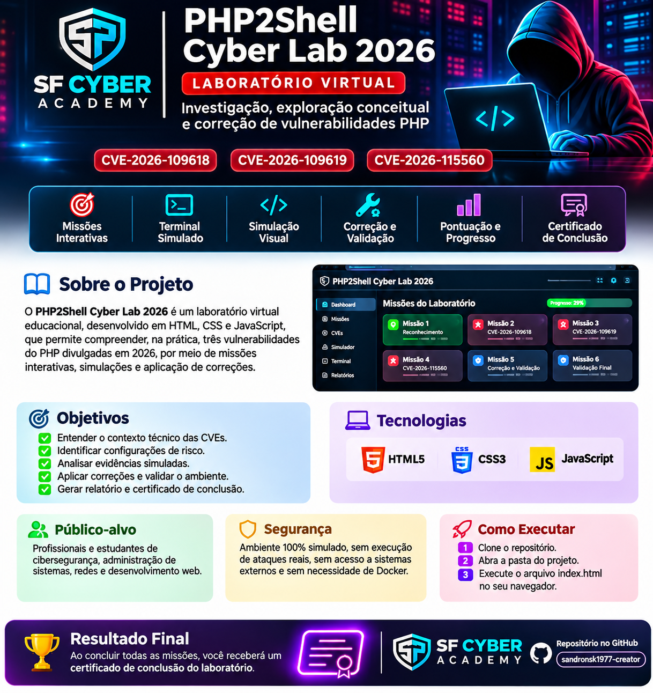

# 🛡️ *SF CYBER ACADEMY* • PHP2Shell Cyber Lab 2026

### Laboratório virtual interativo de cibersegurança

**Investigue. Aprenda. Corrija. Valide.**

  
  
  
  
  

---

## 📌 Sobre o projeto

O **PHP2Shell Cyber Lab 2026** é um laboratório educacional criado para ensinar conceitos de segurança de aplicações web por meio de missões guiadas, evidências simuladas e exercícios de mitigação.

A proposta é oferecer uma experiência prática e visual diretamente no navegador, sem exigir backend, Docker ou conexão com serviços externos para o funcionamento básico planejado.

> **Importante:** o laboratório é educativo. Os cenários simulados não executam ataques reais nem comprovam a existência de vulnerabilidades em sistemas de produção.

## 🎯 Objetivos de aprendizagem

- Compreender o contexto técnico de vulnerabilidades em aplicações web.
- Interpretar evidências e identificar configurações potencialmente arriscadas.
- Exercitar o raciocínio de investigação e resposta a incidentes.
- Aplicar correções conceituais em cenários simulados.
- Comparar o cenário antes e depois da mitigação.
- Consolidar o aprendizado por meio de relatórios e, caso implementado, certificado de conclusão.

## 🧪 Experiência do laboratório

| Área | O que o participante pratica |
|---|---|
| 🧭 Missões | Seguir etapas de aprendizagem com objetivos claros. |
| 🔎 Investigação | Analisar evidências fictícias e identificar possíveis riscos. |
| 💻 Terminal simulado | Aprender conceitos por meio de comandos e saídas demonstrativas, sem executar comandos reais no sistema. |
| 🛠️ Mitigação | Escolher medidas de correção dentro do cenário educacional. |
| 📊 Progresso | Acompanhar as etapas concluídas, se esse recurso estiver disponível na versão atual. |
| 🏆 Conclusão | Consultar um resumo de aprendizagem e certificado, se implementados. |

## 🧰 Tecnologias

| Tecnologia | Utilização |
|---|---|
| **HTML5** | Estrutura das páginas e dos componentes da interface. |
| **CSS3** | Layout responsivo, identidade visual e efeitos da interface. |
| **JavaScript** | Interações, lógica das missões e simulações locais. |

## 🚀 Como executar

1. **Clone ou baixe** este repositório.
2. Abra a pasta do projeto no computador.
3. Localize o arquivo `index.html`.
4. Abra-o em um navegador moderno, como Firefox, Chrome ou Edge.
5. Siga as instruções exibidas no laboratório.

A experiência foi planejada para funcionar localmente. Se a versão atual tiver requisitos adicionais, consulte as instruções e os arquivos presentes no repositório.

## 🔐 Segurança e uso responsável

- Utilize o laboratório apenas para fins educacionais e defensivos.
- Não insira senhas, tokens, chaves de API ou informações confidenciais.
- Não teste sistemas de terceiros sem autorização explícita.
- Considere os terminais, evidências e resultados simulados como material didático — não como execução real.
- Valide qualquer conclusão sobre um sistema real com testes autorizados, documentação técnica e fontes confiáveis.
- Confirme a autenticidade, a descrição, as versões afetadas e o status de CVEs em fontes oficiais antes de usá-las em análises ou relatórios.

### Referências para validação de vulnerabilidades

- [CVE Program](https://www.cve.org/)
- [National Vulnerability Database (NVD)](https://nvd.nist.gov/)

A menção a um identificador CVE neste projeto não confirma, por si só, sua autenticidade ou aplicabilidade a uma versão específica de software. Consulte também os avisos oficiais do fornecedor.

## 👥 Público-alvo

- Estudantes e profissionais iniciantes em cibersegurança.
- Administradores de sistemas e redes.
- Desenvolvedores interessados em desenvolvimento seguro.
- Instrutores que desejam demonstrar conceitos em um ambiente controlado.

## 🗺️ Estado do projeto

Projeto educacional em desenvolvimento. A disponibilidade de recursos como progresso persistente, relatórios e certificado depende da implementação presente na versão publicada. Consulte a aplicação para verificar o que está funcional.

## 🤝 Contribuições

Sugestões e melhorias são bem-vindas. Ao contribuir:

1. Explique o objetivo da mudança.
2. Mantenha o foco educativo, preventivo e defensivo.
3. Não inclua rotinas de exploração contra sistemas reais.
4. Evite coletar ou armazenar dados sensíveis.
5. Valide as referências técnicas antes de publicar informações sobre vulnerabilidades.

## 📄 Licença

A licença ainda precisa ser definida pelo responsável pelo repositório. Antes de reutilizar, modificar ou redistribuir o projeto, confira se existe um arquivo `LICENSE` e quais condições se aplicam.

---

**SF CYBER ACADEMY • PHP2Shell Cyber Lab 2026**

*Aprender segurança na prática e com responsabilidade.*

